# Conception Symfony — classes et séquences

Traduction du modèle de données en entités Doctrine et services Symfony, avec les diagrammes de classes et les séquences des fonctionnalités métier. Les noms suivent les conventions du socle : contrôleurs `final` sans logique, services sans `EntityManagerInterface`, persistance via `save()` et `remove()` des repositories.

## Organisation du code

Le métier vit dans un module `Budget` indépendant des contrôleurs, ce qui permet de le sortir plus tard dans un package partagé, comme `cms-core`.

```text
src/
├── Budget/
│   ├── Entity/           # Board, BoardMember, BudgetItem, BudgetItemRevision, BudgetItemAdjustment,
│   │                     # SplitRule, SplitRuleEntry, BoardLink, Tag, DomainEvent
│   ├── ValueObject/      # Period, Money (Embeddable)
│   ├── Enum/             # BoardType, ItemKind, MemberRole, MemberStatus, Allocation, …
│   ├── Repository/       # save() / remove() + requêtes d'agrégation
│   ├── Dto/              # entrées validées : CreateItemDto, ReviseItemDto, SetAdjustmentDto, InviteMemberDto
│   ├── Calculator/       # BoardCalculator + interfaces de stratégies et leurs implémentations
│   │   ├── Recurrence/   # IntervalRecurrence, SpecificMonthsRecurrence, OneOffRecurrence
│   │   ├── Allocation/   # OnDueAllocation, SmoothedAllocation
│   │   ├── Adjustment/   # ExcludeAdjustment, IncludeAdjustment, AmountAdjustment
│   │   ├── Split/        # EqualsSplit, AmountSplit, PercentageSplit
│   │   └── Link/         # ShareRollupLink
│   ├── Insight/          # InsightService + une classe par InsightRule
│   ├── Service/          # BoardService, ItemService, AdjustmentService, MembershipService
│   ├── Security/         # BoardVoter (VIEW, EDIT, MANAGE_MEMBERS)
│   ├── Event/            # UserActivated, ItemRevised, ItemAdjusted, MemberInvited, MemberJoined
│   └── EventListener/    # CreatePersonalBoard, DomainEventRecorder
└── Controller/Budget/    # BoardController, ItemController, AdjustmentController,
                          # MemberController, InsightController (final, sans logique)
```

| Composant Symfony | Usage dans l'app |
| --- | --- |
| `#[AutoconfigureTag]` + `#[AutowireLocator]` | Chaque stratégie s'enregistre sous son code (`interval`, `on_due`…) ; le calculateur la récupère par ce code |
| EventDispatcher | Événements métier (`ItemRevised`…) ; `DomainEventRecorder` les écrit dans le journal |
| Workflow (state machine) | Statut d'un membre : invited → active → left |
| Security Voter | `BoardVoter` : un membre ne voit que ses boards, seul le propriétaire gère les membres |
| Validator | DTO validés, puis paramètres JSON validés par la stratégie concernée |
| Messenger (lot 3) | Notifications envoyées en asynchrone à partir des événements |

## Mapping Doctrine

La règle clé : un **ensemble fermé** (type de poste, rôle, statut) devient un enum PHP ; un **ensemble ouvert** (récurrence, mode, répartition, type d'exception, de lien ou de board) reste un code texte validé par le registre des stratégies. Ajouter une stratégie ne modifie donc ni la base ni un enum existant.

| Besoin | Choix Doctrine | Pourquoi |
| --- | --- | --- |
| Identifiants | `UuidType`, `Uuid::v7()` dans le constructeur | Triables dans le temps, comme le socle |
| Montants | `#[ORM\Embeddable] Money` : `amount_cents` BIGINT + `currency` CHAR(3) | Aucun float ; la devise est déjà là pour le multi-devises |
| Périodes | Type DBAL `period` (DATE au 1er du mois) ↔ Value Object `Period` | Comparable en SQL ; impossible de stocker un « 15 du mois » par erreur |
| Ensembles fermés | Enum PHP backed + `enumType`, colonne VARCHAR(32) | Typé en PHP, pas d'ENUM SQL à migrer |
| Ensembles ouverts | `string` VARCHAR(32) + paramètres `json` | Nouvelle stratégie = nouvelle classe taguée |
| Faits (révision, exception, journal) | `readOnly: true`, constructeur complet, aucun setter | Doctrine n'émet jamais d'UPDATE sur ces lignes |
| Suppression | `archived_at` sur Board et BudgetItem | Les révisions et le journal gardent leurs références |

Les entités ne sont pas `final` (Doctrine a besoin de proxies pour le chargement différé) ; les services, handlers et contrôleurs le sont.

**Exemple : une révision, immuable par construction**

```php
#[ORM\Entity(repositoryClass: BudgetItemRevisionRepository::class, readOnly: true)]
#[ORM\UniqueConstraint(columns: ['item_id', 'effective_from'])]
class BudgetItemRevision
{
    #[ORM\Id, ORM\Column(type: UuidType::NAME)]
    private Uuid $id;

    #[ORM\Column]
    private \DateTimeImmutable $createdAt;

    public function __construct(
        #[ORM\ManyToOne(inversedBy: 'revisions'), ORM\JoinColumn(nullable: false)]
        private BudgetItem $item,
        #[ORM\Column(type: PeriodType::NAME)]
        private Period $effectiveFrom,
        #[ORM\Embedded(columnPrefix: false)]
        private Money $amount,
        #[ORM\Column(length: 32)]
        private string $recurrenceType,          // code ouvert : 'interval', 'specific_months', 'one_off'…
        #[ORM\Column(type: Types::JSON)]
        private array $recurrenceParams,         // ex. ['interval' => 2, 'anchor' => '2026-01']
        #[ORM\Column(length: 32)]
        private string $allocation,              // code ouvert : 'on_due', 'smoothed'
        #[ORM\Column(type: PeriodType::NAME, nullable: true)]
        private ?Period $endPeriod = null,
        #[ORM\Column(type: Types::SMALLINT, nullable: true)]
        private ?int $dueDay = null,
        #[ORM\ManyToOne]
        private ?BoardMember $paidBy = null,
    ) {
        $this->id = Uuid::v7();
        $this->createdAt = new \DateTimeImmutable();
    }

    // Uniquement des getters : une correction crée une nouvelle révision.
}
```

## Diagramme de classes — entités

Un `BudgetItem` décrit *quoi* ; ses révisions disent *combien et quand*, ses exceptions modifient un mois, et les règles de répartition disent *qui paie*. Les classes `readOnly` n'ont aucun setter.

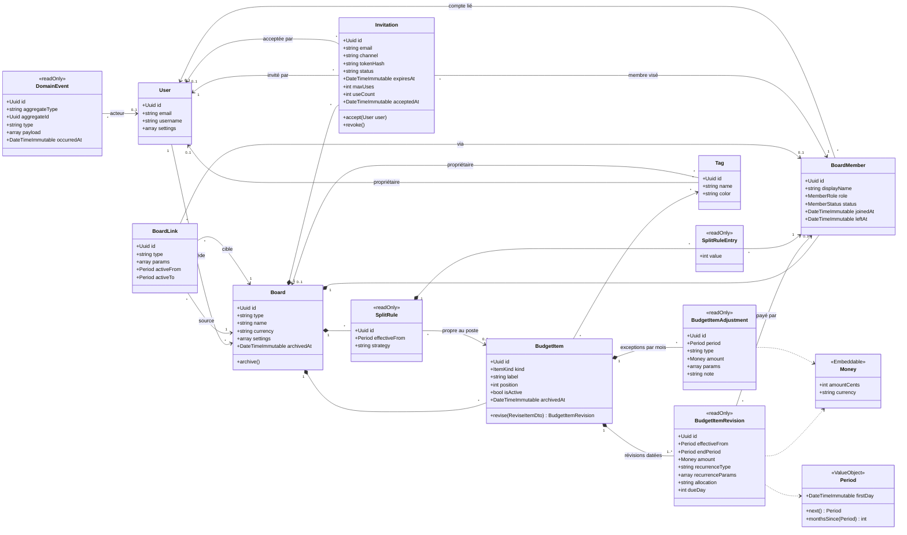

**Contraintes en base :** unique `[board_id, user_id]` sur BoardMember, `[item_id, effective_from]` sur BudgetItemRevision, `[item_id, period]` sur BudgetItemAdjustment, `[split_rule_id, member_id]` sur SplitRuleEntry. Un tag a exactement un propriétaire, utilisateur ou board (contrainte CHECK).

## Diagramme de classes — calcul et extensions

`BoardCalculator` ne connaît que des interfaces. Chaque implémentation est un service `final` tagué par son code (`#[AsTaggedItem('interval')]`) et récupéré via `#[AutowireLocator]` : ajouter une stratégie revient à créer une classe, sans modifier le calculateur.

```mermaid
classDiagram
    direction TB

    class BoardCalculator {
        <<service final>>
        +calculate(Board board, Period period) BoardResult
    }
    class RevisionResolver {
        <<service final>>
        +resolve(BudgetItem item, Period period) BudgetItemRevision
    }
    class BalanceCalculator {
        <<service final>>
        +compute(array shares, array paidBy) Balance
    }
    class BoardResult {
        +Period period
        +array lines
        +array totals
        +array memberShares
        +Balance balance
    }

    class RecurrenceHandlerInterface {
        <<interface>>
        +isDue(BudgetItemRevision rev, Period period) bool
        +intervalMonths(BudgetItemRevision rev) int
        +validateParams(array params) ConstraintViolationList
    }
    class AllocationHandlerInterface {
        <<interface>>
        +amountFor(BudgetItemRevision rev, Period period, bool isDue) Money
    }
    class AdjustmentHandlerInterface {
        <<interface>>
        +apply(BudgetItemAdjustment adj, Money amount, bool isDue) Money
    }
    class SplitStrategyInterface {
        <<interface>>
        +split(Money amount, SplitRule rule, array members) array
    }
    class BoardLinkHandlerInterface {
        <<interface>>
        +contribute(BoardLink link, Period period) array
    }
    class InsightRuleInterface {
        <<interface>>
        +supports(InsightContext context) bool
        +evaluate(InsightContext context) array
    }

    BoardCalculator --> RevisionResolver
    BoardCalculator --> RecurrenceHandlerInterface : par recurrenceType
    BoardCalculator --> AllocationHandlerInterface : par allocation
    BoardCalculator --> AdjustmentHandlerInterface : par type
    BoardCalculator --> SplitStrategyInterface : par strategy
    BoardCalculator --> BoardLinkHandlerInterface : par type de lien
    BoardCalculator --> BalanceCalculator
    BoardCalculator ..> BoardResult : produit

    IntervalRecurrence ..|> RecurrenceHandlerInterface
    SpecificMonthsRecurrence ..|> RecurrenceHandlerInterface
    OneOffRecurrence ..|> RecurrenceHandlerInterface
    OnDueAllocation ..|> AllocationHandlerInterface
    SmoothedAllocation ..|> AllocationHandlerInterface
    ExcludeAdjustment ..|> AdjustmentHandlerInterface
    IncludeAdjustment ..|> AdjustmentHandlerInterface
    AmountAdjustment ..|> AdjustmentHandlerInterface
    EqualsSplit ..|> SplitStrategyInterface
    AmountSplit ..|> SplitStrategyInterface
    PercentageSplit ..|> SplitStrategyInterface
    ShareRollupLink ..|> BoardLinkHandlerInterface
    ShareRollupLink --> BoardCalculator : calcule le board source
    InsightService --> InsightRuleInterface : itère sur les règles taguées
    InsightService --> BoardCalculator
    NegativeRemainingRule ..|> InsightRuleInterface
    ChargesRatioRule ..|> InsightRuleInterface
    UpcomingLargeDueRule ..|> InsightRuleInterface
```

Un code inconnu (une valeur en base sans classe correspondante) lève une exception explicite du registre, plutôt que d'être ignoré silencieusement.

## Diagrammes de séquence

### 1. Activation du compte et création du board perso

Le board perso est créé par un listener d'événement, pas par `AuthService` : l'authentification reste indépendante du budget, et la création est idempotente.

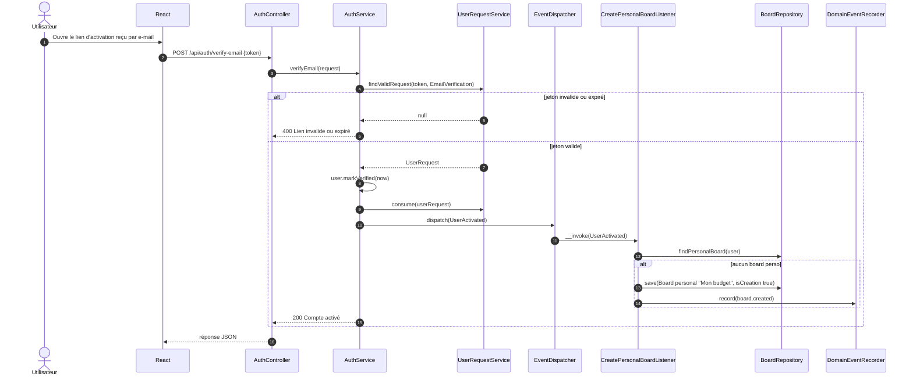

### 2. Calcul d'un board partagé pour un mois

C'est le cœur de l'application : chaque étape délègue à la stratégie désignée par un code en base. Rien n'est stocké : les totaux sont recalculés à chaque lecture.

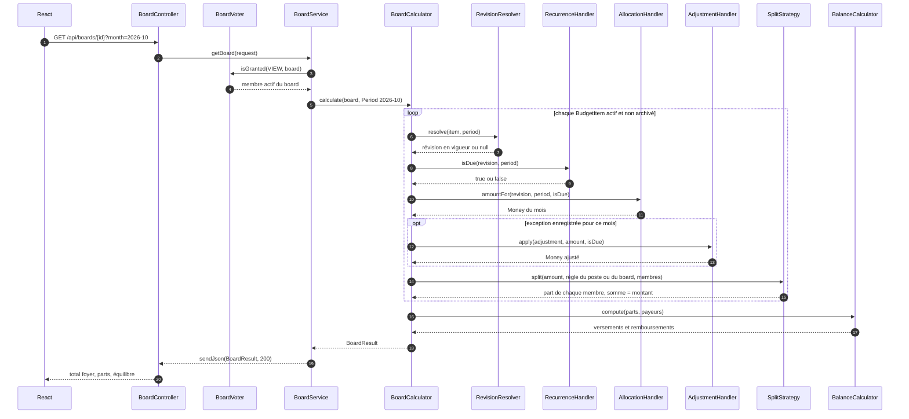

Les révisions, exceptions et règles du mois sont chargées en une requête par type avant la boucle, pour éviter les N+1.

### 3. Board perso et remontée des quotes-parts

La remontée n'est pas codée en dur : c'est un `BoardLink` de type `share_rollup`, traité par sa stratégie. Un autre type de lien (objectif d'épargne) suivra le même chemin.

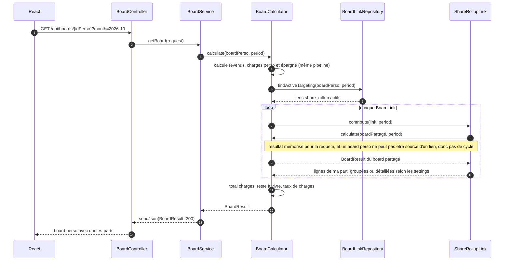

### 4. Modifier un poste : nouvelle révision

Modifier un montant ou une fréquence ne met jamais à jour une ligne : une révision est créée à partir du mois choisi. Seule la révision du même mois peut être remplacée, et le journal garde l'avant et l'après.

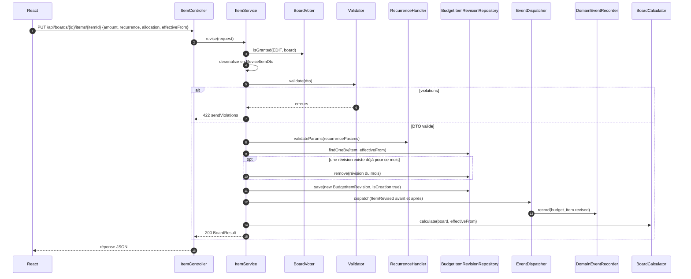

### 5. Exception d'un mois

Exemple : la facture d'électricité de mars arrive à 97,40 € au lieu de 85 €. Le type d'exception (`amount`) désigne la stratégie qui valide et applique la correction.

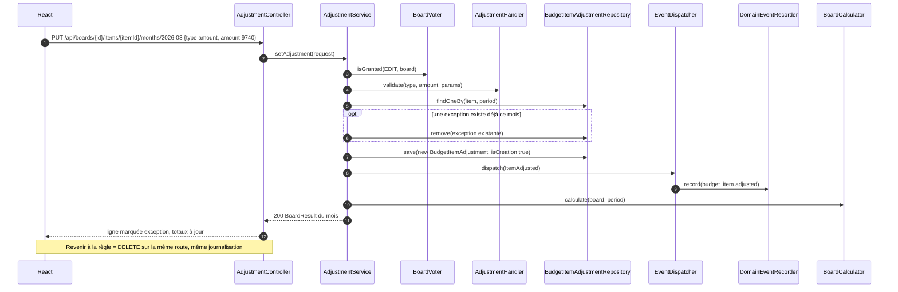

### 6. Inviter un membre et accepter l'invitation

L'invitation est portée par une entité dédiée, `Invitation`, commune aux boards partagés et aux groupes de dépenses puisque les deux sont des `Board`. Tant qu'elle n'est pas acceptée, le membre se comporte comme un invité local : sa part est calculée, mais rien ne remonte dans un board perso. Ce qui se passe à l'acceptation dépend du type de board, via son `BoardTypeHandler`.

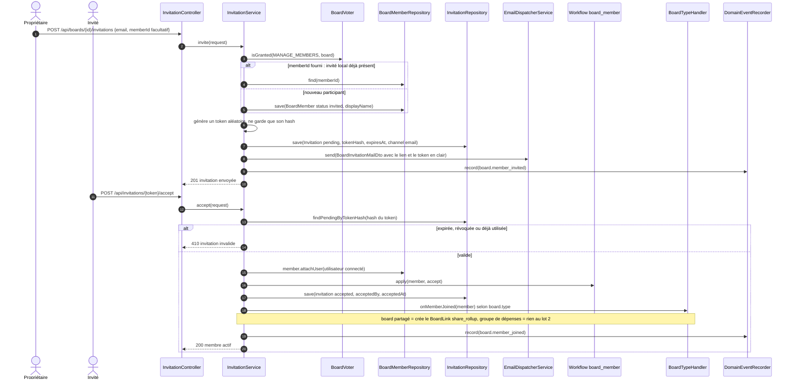

**Pourquoi pas `UserRequest` ?** Dans le socle, `UserRequest` est lié à un compte existant et sert aux parcours d'authentification (vérification d'e-mail, mot de passe oublié). Une invitation doit pouvoir viser une adresse sans compte, porter le board et le membre concernés, et fonctionner en lien partageable à usages multiples (`channel` = link, `maxUses`) pour le lot 4. `UserRequest` reste donc réservé à l'authentification, sans nouveau type.

### 7. Insights de l'accueil

L'accueil réutilise le calculateur sur trois mois (le mois affiché et les deux suivants) pour détecter les grosses échéances. Chaque règle est une classe taguée, indépendante des autres.

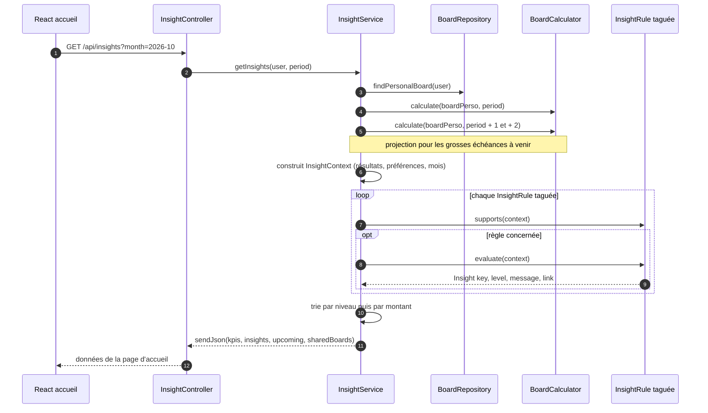

## Module ExpenseSplitter

Le module vit dans `src/ExpenseSplitter/` (entités `Expense`, `ExpenseShare`, `Settlement`, leurs services et contrôleurs). Il dépend du module `Budget` uniquement par ses interfaces et entités de structure, jamais l'inverse.

### Diagramme de classes

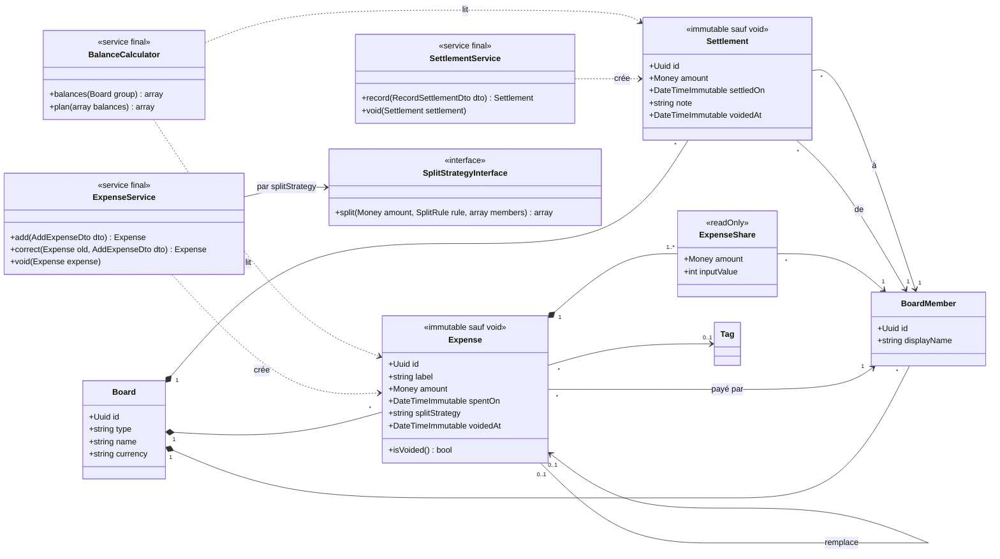

`voidedAt` est la seule écriture autorisée sur une dépense ou un remboursement déjà enregistré : on ne supprime rien, pour que les soldes passés restent explicables. Pour que Doctrine l'accepte, ces deux entités ne sont pas en `readOnly` : l'immuabilité est garantie par l'absence de setters, sauf `void()`.

### Séquence 8 — Ajouter une dépense

La répartition est calculée par la même `SplitStrategy` que les boards, puis figée dans `ExpenseShare`.

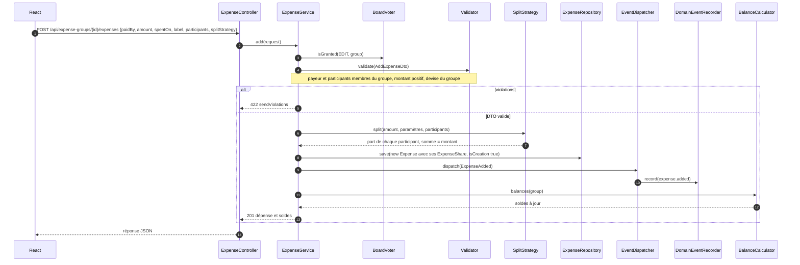

Corriger une dépense suit le même chemin : la nouvelle dépense porte `supersedes_id`, l'ancienne reçoit `voidedAt`, dans la même transaction.

### Séquence 9 — Soldes et plan de virements

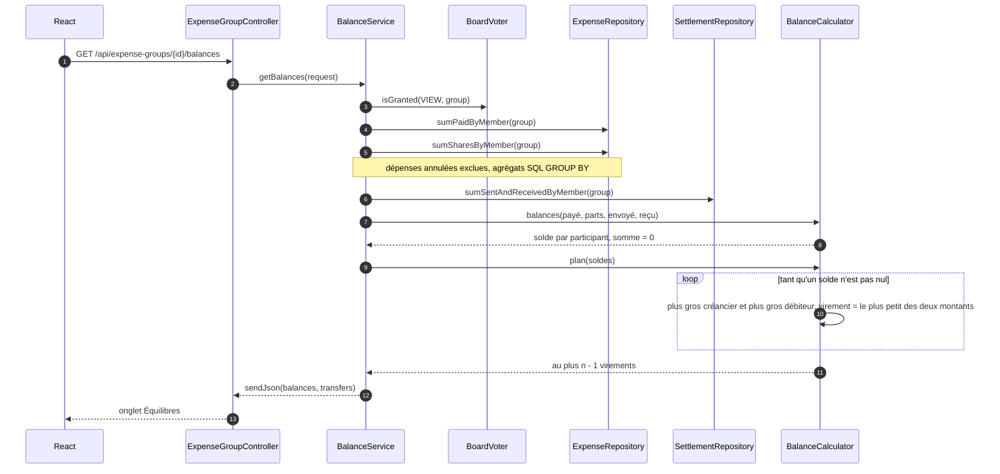

### Séquence 10 — Enregistrer un remboursement

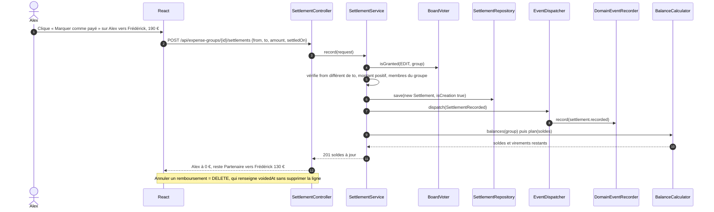
